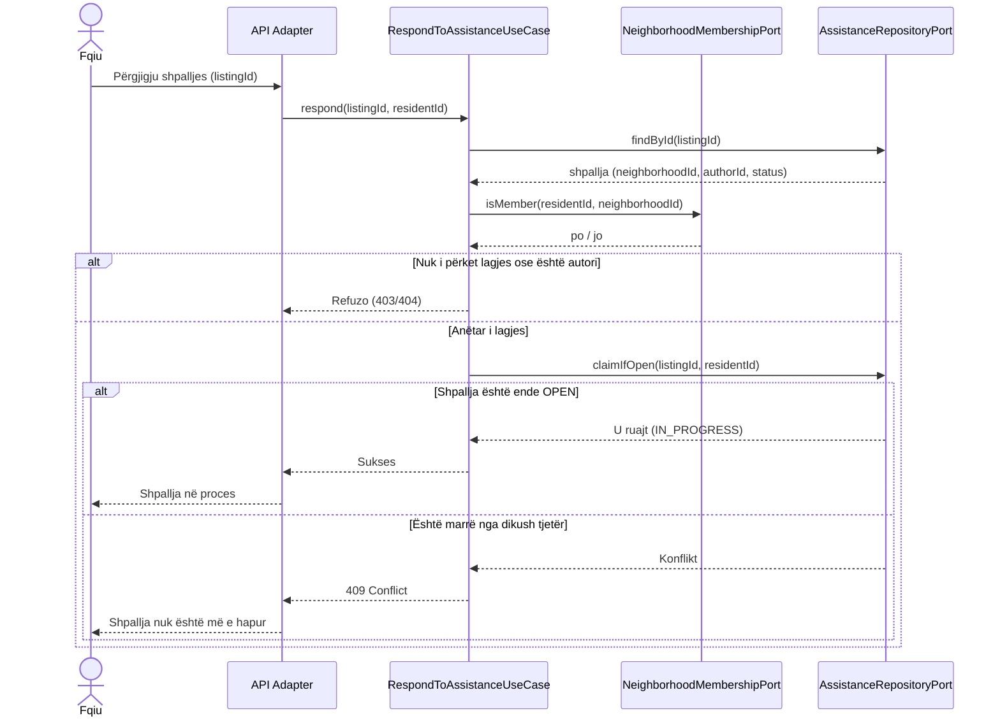
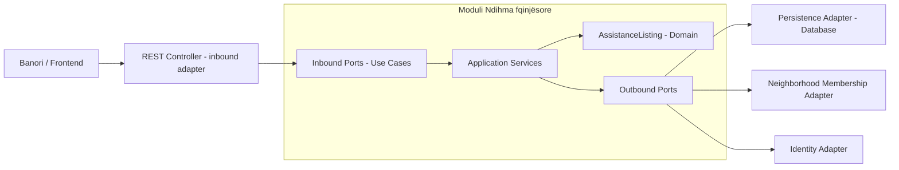
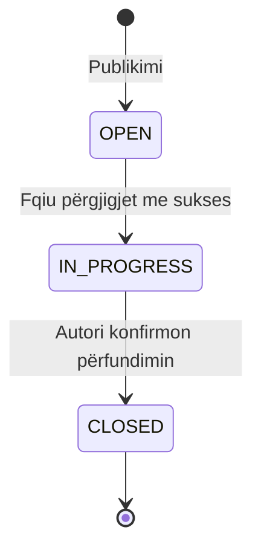

# Arkitektura e modulit: Ndihma fqinjësore

> **Kërkesa 2 — Dokumentimi i arkitekturës së modulit sipas DeSCRIPTR**  
> **Moduli:** Ndihma fqinjësore  
> **Përgjegjës:** Anëtari përgjegjës për modulin  
> **Statusi:** Propozim arkitekturor për rishikim nga grupi  
> **Stili arkitekturor:** Arkitekturë heksagonale (Ports & Adapters)

## 1. Qëllimi dhe kufijtë e modulit

Moduli **Ndihma fqinjësore** u mundëson banorëve të publikojnë një **kërkesë** ose **ofertë** për ndihmë në lagjen e tyre. Banorët e së njëjtës lagje mund t'i shohin shpalljet dhe një fqinj mund t'i përgjigjet një shpalljeje të hapur. Pas përgjigjes së suksesshme, shpallja kalon **E HAPUR → NË PROCES**; pas përfundimit, kalon **NË PROCES → E MBYLLUR**.

**Brenda përgjegjësisë:** publikimi, shfaqja sipas lagjes, përgjigjja/pranimi i një fqinji, ndryshimi i statusit dhe mbyllja.  
**Jashtë përgjegjësisë së këtij moduli:** regjistrimi/login-i, menaxhimi i lagjeve, chat-i, pagesat, vlerësimet dhe njoftimet në kohë reale; nëse ekzistojnë në sistem, përdoren përmes portave dhe jo si logjikë e brendshme.

### Vendime / supozime që kërkojnë miratim nga grupi

1. Një shpallje mund të ketë **vetëm një banor të caktuar si përgjegjës**. Përgjigjja e parë e pranuar e kalon automatikisht shpalljen në `IN_PROGRESS`.
2. **Autori i shpalljes** e mbyll shpalljen pasi të përfundojë ndihma. Kjo politikë mund të ndryshohet me vendim të grupit.
3. Përdoruesit duhet të jenë të identifikuar dhe të kenë anëtarësi të verifikuar në lagjen përkatëse.
4. Editimi, anulimi, rihapja dhe skadimi automatik nuk kërkohen në përshkrimin aktual; prandaj nuk janë pjesë e rrjedhës bazë.
5. Kufijtë numerikë të performancës më poshtë janë **objektiva të propozuar**, jo kërkesa të konfirmuara nga klienti.

---

## S — Gjendjet e dukshme nga jashtë (States)

| Gjendja | Kodi | Kuptimi për banorin | Veprime të lejuara |
|---|---|---|---|
| E hapur | `OPEN` | Shpallja është publikuar dhe pret një fqinj | Shikim; përgjigje nga një fqinj i përshtatshëm |
| Në proces | `IN_PROGRESS` | Një fqinj ka marrë përsipër ndihmën | Shikim; mbyllje nga autori pas përfundimit |
| E mbyllur | `CLOSED` | Ndihma është përfunduar dhe shpallja është mbyllur | Shikim historik, nëse lejohet nga politika e sistemit |

`REQUEST` (*kërkesë*) dhe `OFFER` (*ofertë*) janë **lloje shpalljesh**, jo gjendje.

**Rregull i dukshmërisë:** një banor sheh vetëm shpalljet që i përkasin lagjes së tij të autorizuar. Shfaqja dhe filtrimi bëhen në server, jo vetëm në ndërfaqen grafike.

## C — Bashkëpunimet (Collaborations)

**Aktorët:** autori i shpalljes, fqiu që përgjigjet, aplikacioni (UI/API), shërbimi i modulit, shërbimi i lagjeve/anëtarësisë dhe depoja e të dhënave.

| Rrjedha | Kush vepron | Rendi i bashkëpunimit | Rezultati |
|---|---|---|---|
| Publikimi | Autori | Dërgon të dhënat → verifikohet identiteti/lagjja → ruhen të dhënat | Shpallje e re `OPEN` |
| Shfletimi | Banori i lagjes | Kërkon listën → verifikohet lagjja → lexohen shpalljet e autorizuara | Listë shpalljesh për atë lagje |
| Përgjigjja | Fqiu | Zgjedh shpalljen → kontrollohet lagjja dhe statusi → ruhet përgjigjja në mënyrë atomike | Një banor caktohet; statusi `IN_PROGRESS` |
| Mbyllja | Autori | Konfirmon përfundimin → verifikohet pronësia dhe statusi → përditësohet shpallja | Statusi `CLOSED` |

### Diagram i bashkëpunimit për përgjigjen ndaj shpalljes



## R — Përgjegjësitë (Responsibilities): të dhënat dhe sjellja

### Modeli i domenit

Agregati kryesor është **`AssistanceListing`** (Shpallja e ndihmës).

| Fusha | Tipi konceptual | Përgjegjësia |
|---|---|---|
| `id` | UUID | Identifikues unik |
| `type` | `REQUEST` / `OFFER` | Lloji i shpalljes |
| `title` | tekst | Titulli |
| `description` | tekst | Përshkrimi i nevojës/ofertës |
| `authorId` | UUID | Banori që publikon |
| `neighborhoodId` | UUID | Lagjja ku publikohet |
| `status` | `OPEN` / `IN_PROGRESS` / `CLOSED` | Gjendja aktuale |
| `responderId` | UUID, nullable | Banori që ka marrë përsipër ndihmën |
| `createdAt` | timestamp | Koha e publikimit |
| `startedAt` | timestamp, nullable | Koha e përgjigjes së pranuar |
| `closedAt` | timestamp, nullable | Koha e mbylljes |
| `version` | integer | Mbron nga përditësime konkurruese |

### Sjelljet dhe invariantet

- `publish(...)`: validon titullin/përshkrimin dhe krijon shpallje me `status=OPEN` dhe `responderId=null`.
- `respond(residentId)`: lejon kalimin vetëm nga `OPEN`; banori nuk mund t'i përgjigjet shpalljes së vet dhe duhet të jetë nga lagjja përkatëse.
- `close(actorId)`: lejon kalimin vetëm nga `IN_PROGRESS`; sipas politikës së propozuar, aktori duhet të jetë autori.
- Një shpallje në `IN_PROGRESS` ka **saktësisht një** `responderId`.
- Një shpallje `CLOSED` nuk pranon përgjigje të reja.
- Autorizimi i lagjes dhe i pronarit kryhet **në backend** për çdo veprim përkatës.
- Përgjigjjet konkurruese trajtohen me **transaksion dhe kontroll atomik të statusit**, p.sh. përditësim kushtor `WHERE status='OPEN'` ose optimistic locking (`version`). Vetëm një kërkesë fiton.

## I — Ndërfaqja: portat e modulit (Interface)

Në arkitekturën heksagonale, **portat hyrëse janë shërbimet që ofron moduli** (*inbound/use-case ports*), ndërsa **portat dalëse janë shërbimet që moduli kërkon nga komponentët e tjerë** (*outbound/required ports*). Portat janë kontrata; adapterat REST dhe të bazës së të dhënave janë implementime të tyre.

### I.1 Portat hyrëse — shërbimet e ofruara

| Porta / operacioni | Parakushtet | Paskushtet në sukses |
|---|---|---|
| `PublishAssistanceUseCase.publish(command)` | Autori i autentikuar; anëtar i lagjes; të dhëna valide | Krijohet një `AssistanceListing` i ri me `OPEN`, autor dhe lagje të ruajtur |
| `BrowseNeighborhoodAssistanceUseCase.list(query)` | Banori i autentikuar; lagjja e kërkuar e autorizuar | Kthehen vetëm shpalljet e lagjes së autorizuar, me filtra sipas statusit/llojit |
| `GetAssistanceDetailsUseCase.get(id)` | Banori është i autorizuar për lagjen e shpalljes | Kthehen detajet e shpalljes; nuk ekspozohen të dhëna të lagjeve të tjera |
| `RespondToAssistanceUseCase.respond(id, residentId)` | Banori i autentikuar, nga e njëjta lagje, jo autor; shpallja `OPEN` | Vendoset një `responderId`; statusi bëhet `IN_PROGRESS`; caktohet `startedAt` |
| `CloseAssistanceUseCase.close(id, actorId)` | Aktori është autori; shpallja `IN_PROGRESS` | Statusi bëhet `CLOSED`; caktohet `closedAt` |

Nëse parakushtet nuk plotësohen, operacioni **nuk ndryshon gjendjen**. Adapteri API i përkthen gabimet e domenit në përgjigje të përshtatshme, si `400`, `401`, `403`/`404` ose `409`.

### I.2 Portat dalëse — shërbimet e kërkuara

| Porta / operacioni | Parakushtet | Paskushtet / kontrata e pritshme |
|---|---|---|
| `AssistanceRepositoryPort.save(listing)` | Shpallja ka kaluar validimin e domenit | Shpallja ruhet në mënyrë të qëndrueshme ose kthehet gabim; pa ruajtje të pjesshme |
| `AssistanceRepositoryPort.findById(id)` | `id` valid | Kthehet shpallja ose `not found`; nuk ndryshohen të dhëna |
| `AssistanceRepositoryPort.findByNeighborhood(neighborhoodId, filters, page)` | Lagjja është autorizuar nga use case | Kthen rezultate të filtruara e të faqosura vetëm për atë lagje |
| `AssistanceRepositoryPort.claimIfOpen(id, residentId)` | Validimet e identitetit/lagjes janë kryer | Atomikisht: vetëm nëse gjendja është `OPEN`, ruan `responderId` dhe `IN_PROGRESS`; përndryshe konflikt pa ndryshim |
| `NeighborhoodMembershipPort.isMember(residentId, neighborhoodId)` | Identifikuesit janë validë | Kthen përgjigje të verifikueshme `true/false`; nuk modifikon shpallje |
| `AuthenticatedResidentPort.currentResident()` | Kërkesë API me kredenciale të verifikuara | Kthen identitetin e banorit të autentikuar; nuk merret `residentId` i besuar nga klienti |

**Opsionale:** `NotificationPort` mund të njoftojë autorin kur një fqinj përgjigjet ose kur shpallja mbyllet. Dështimi i njoftimit nuk duhet të zhbëjë transaksionin bazë; përdoret një event/outbox nëse sistemi e kërkon.

### I.3 Shembull i adapterit REST (jo pjesë e kontratës së domenit)

| Metoda | Rruga e propozuar | Porta hyrëse |
|---|---|---|
| `POST` | `/api/assistance` | `publish` |
| `GET` | `/api/assistance?status=OPEN&type=REQUEST` | `list` (lagjja merret nga konteksti i autorizuar) |
| `GET` | `/api/assistance/{id}` | `get` |
| `POST` | `/api/assistance/{id}/respond` | `respond` |
| `POST` | `/api/assistance/{id}/close` | `close` |

Për krijim, përgjigje dhe mbyllje, identiteti nxirret nga konteksti i autentikimit. API nuk lejon që klienti të zgjedhë lirisht `authorId` ose `responderId`.

### I.4 Pamja e arkitekturës heksagonale



**Drejtimi i varësive:** adapterat varen nga kontratat e portave; domeni nuk varet nga REST, databaza apo framework-u. Nuk lejohet logjikë biznesi në controller ose në query-t e UI-së.

## P — Vetitë e cilësisë (Properties)

| Veti | Objektivi / mekanizmi i propozuar | Verifikimi |
|---|---|---|
| Performanca e shfletimit | `p95 ≤ 400 ms` për listimin e faqosur me 100 banorë aktivë dhe të paktën 1,000 shpallje testuese në lagje | Load test; indeks `(neighborhood_id, status, created_at)` |
| Konsistenca / besueshmëria | Një shpallje ka maksimumi një fqinj përgjegjës, edhe kur dy kërkesa vijnë njëkohësisht | Test konkurrues dhe transaksional |
| Siguria / privatësia | Banori nuk mund të lexojë/ndryshojë shpallje të lagjeve ku nuk është i autorizuar | Teste autorizimi dhe kontroll i filtrave në server |
| Gjurmueshmëria | Ruajtja e `createdAt`, `startedAt`, `closedAt` dhe identifikuesit të vepruesit | Teste të ngjarjeve dhe të gjendjeve |
| Mirëmbajtja | Use case-et dhe domeni testohen pa server HTTP apo databazë reale | Unit tests me zëvendësim të portave dalëse |

**Shënim:** objektivi i performancës është për diskutim dhe kalibrim gjatë integrimit; nuk duhet paraqitur si rezultat i matur pa ekzekutuar testet.

## T — Kalimet mes gjendjeve (Transitions)



| Nga | Ngjarja | Kushti mbrojtës (guard) | Në | Në rast dështimi |
|---|---|---|---|---|
| Nuk ekziston | `publish` | Banor i autorizuar dhe fusha valide | `OPEN` | Nuk krijohet shpallje |
| `OPEN` | `respond` | E njëjta lagje; jo autor; një përgjigje fituese | `IN_PROGRESS` | Nuk ndryshon; `403/404` ose `409` |
| `IN_PROGRESS` | `close` | Autori e konfirmon | `CLOSED` | Nuk ndryshon; `403` ose `409` |

**Kalime të ndaluara në këtë version:** `OPEN → CLOSED`, `IN_PROGRESS → OPEN`, `CLOSED → IN_PROGRESS`, `CLOSED → OPEN`. Për kalime të tjera duhet kërkesë e re dhe rishikim i rregullave të domenit.

## R — Marrëdhëniet: përdorimet dhe varësitë (Relationships)

| Komponenti | Marrëdhënia me modulin | Kufizimi arkitekturor |
|---|---|---|
| UI / Frontend | **Përdor** portat hyrëse nëpërmjet REST adapterit | Nuk zbaton rregulla statusi si burim autoritar |
| Identity/Auth | **Furnizon** identitetin e autentikuar përmes adapterit dalës | Moduli nuk implementon login-in |
| Lagjet/banorët | **Furnizon** anëtarësinë e lagjes përmes `NeighborhoodMembershipPort` | Moduli nuk i kopjon rregullat e regjistrimit të lagjeve |
| Database | **Ruajtja kërkohet** përmes `AssistanceRepositoryPort` | Domeni nuk njeh SQL/ORM |
| Njoftimet (opsionale) | **Konsumon** evente nga moduli | Dështimi i tyre nuk komprometon statusin e shpalljes |

**Strukturë e mundshme në kod (përshtatet me teknologjinë e grupit):**

```text
assistance/
├── domain/
│   ├── AssistanceListing
│   ├── AssistanceStatus
│   └── AssistanceType
├── application/
│   ├── port/in/       # use cases të ofruara
│   ├── port/out/      # repository, membership, identity
│   └── service/       # orkestrimi i rasteve të përdorimit
└── adapter/
    ├── in/rest/       # controller / DTO
    └── out/           # persistence / integrimet
```

---

## 2. Dy skenarët e cilësisë (për pemën e dobisë së grupit)

Për klasifikimin **H/M/L** përdorim: `H = High (e lartë)`, `M = Medium (mesatare)`, `L = Low (e ulët)`. Jepet **rëndësia** dhe **vështirësia/rreziku i realizimit**, siç përdoret zakonisht në pemën e dobisë. Këto janë vlerësime të propozuara nga përgjegjësi i modulit dhe duhen harmonizuar me grupin.

### QS-NF-01 — Performanca e shfletimit të shpalljeve

| Elementi i skenarit | Përshkrimi |
|---|---|
| Atributi | Performanca |
| Burimi i stimulit | Banorët e autentikuar të së njëjtës lagje |
| Stimuli | 100 banorë aktivë kërkojnë njëkohësisht listën e shpalljeve |
| Mjedisi | Ngarkesë e zakonshme/e shtuar; databazë testuese me ≥1,000 shpallje për lagje |
| Artefakti | `BrowseNeighborhoodAssistanceUseCase` + repository/DB adapter |
| Përgjigjja | Sistemi kthen listë të faqosur, të renditur dhe të filtruar sipas lagjes së autorizuar |
| Masa e përgjigjes | `p95 ≤ 400 ms` për API-n e listimit; pa rrjedhje të shpalljeve të lagjeve të tjera |
| Rëndësia | **H** |
| Vështirësia | **M** |

**Taktika:** faqosje, indeksim sipas lagjes/statusit, kufizim i fushave të lexuara dhe load testing. Objektivi është propozim dhe matet gjatë implementimit.

### QS-NF-02 — Besueshmëria e përgjigjes konkurruese

| Elementi i skenarit | Përshkrimi |
|---|---|
| Atributi | Besueshmëria / konsistenca |
| Burimi i stimulit | Dy banorë të autorizuar të së njëjtës lagje |
| Stimuli | Të dy tentojnë t'i përgjigjen **të njëjtës** shpallje `OPEN` në të njëjtën kohë |
| Mjedisi | Operim normal me kërkesa paralele në API |
| Artefakti | `RespondToAssistanceUseCase` + `AssistanceRepositoryPort` |
| Përgjigjja | Vetëm një përgjigje pranohet dhe shpallja kalon atomikisht në `IN_PROGRESS`; tjetra refuzohet |
| Masa e përgjigjes | Në **100 prova konkurruese**, çdo herë ekziston saktësisht një `responderId`; një sukses dhe një `409 Conflict`; asnjë caktim i dyfishtë |
| Rëndësia | **H** |
| Vështirësia | **H** |

**Taktika:** transaksion DB, `UPDATE ... WHERE status='OPEN'`, kontroll i numrit të rreshtave të ndryshuar dhe/ose optimistic locking me `version`; test integrimi me dy kërkesa paralele.

### Fragment për pemën e dobisë (Utility Tree)

```text
Utility (Dobishmëria)
├── Performance (Performanca)
│   └── QS-NF-01: Shfletimi i shpalljeve, p95 ≤ 400 ms [Rëndësia H / Vështirësia M]
└── Reliability (Besueshmëria)
    └── QS-NF-02: Vetëm një fqinj përgjegjës në konkurencë [Rëndësia H / Vështirësia H]
```

Ky fragment **i dërgohet anëtarit që integron pemën e dobisë së grupit**; nuk zëvendëson pemën e plotë të grupit.

---

## 3. Kritere pranimi / vetëkontroll i kërkesës së sprint-it

- [x] **S:** tri gjendjet e dukshme dhe dy llojet e shpalljeve janë sqaruar.
- [x] **C:** rolet, rrjedhat dhe rendi i bashkëpunimeve janë dokumentuar.
- [x] **R (përgjegjësitë):** të dhënat, sjelljet dhe invariantet janë përcaktuar.
- [x] **I:** portat hyrëse/dalëse kanë shërbime, parakushte dhe paskushte.
- [x] **P:** performanca, besueshmëria dhe siguria kanë objektiva ose taktika.
- [x] **T:** kalimet dhe kushtet mbrojtëse janë specifikuar.
- [x] **R (marrëdhëniet):** përdorimet dhe varësitë e modulit janë përshkruar.
- [x] **2 skenarë cilësie:** të dy janë shkruar me stimul, mjedis, reagim, matje dhe H/M/L.
- [ ] **Integrimi i grupit:** fragmenti i dy skenarëve duhet të bashkohet me pemën e dobisë së projektit.
- [ ] **Rishikimi i supozimeve:** grupi të konfirmojë kush e mbyll shpalljen dhe politikën e pranimit të një fqinji.

**Përfundim:** Moduli është dokumentuar në nivel arkitekturor. Ky dokument **nuk pretendon** se funksionaliteti është implementuar ose se objektivat e cilësisë janë testuar.
